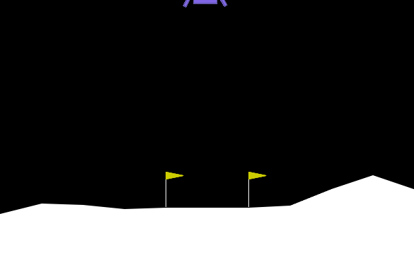
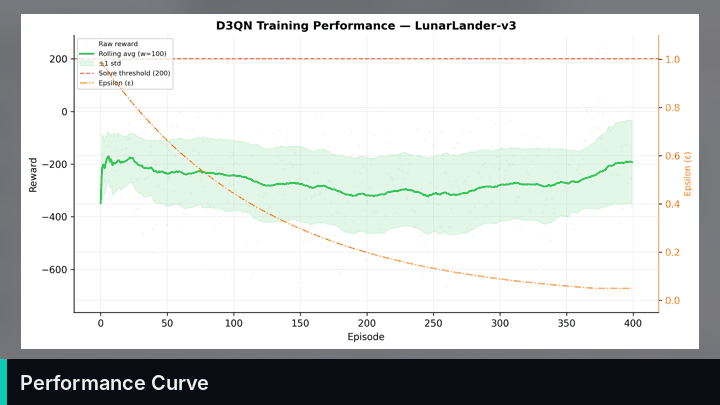
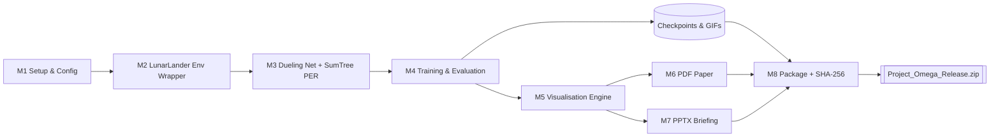

<div align="center">



# 🚀 Project Omega

### End-to-end D3QN research pipeline on LunarLander — from training to paper, slides and release

    

[](LICENSE)    

[](https://codespaces.new/shiroonigami23-ui/omega?quickstart=1) [](https://github.com/shiroonigami23-ui/omega/archive/refs/heads/main.zip)

[**Overview**](#-overview) · [**Features**](#-features) · [**Architecture**](#-architecture) · [**Getting Started**](#-getting-started) · [**Roadmap**](#-roadmap)

</div>

---

## 📸 Preview

<p align="center"></p>

## 📖 Overview

**Project Omega** is a complete, self-documenting reinforcement-learning research pipeline. It trains and compares four
value-based agents — **Vanilla DQN, DQN + Prioritised Experience Replay, Dueling DQN and the full D3QN**
(Dueling + Double + PER) — on `LunarLander-v2`, then automatically turns the results into publication-ready artefacts:
plots, agent GIFs, a NeurIPS/ICML-style research paper (PDF), an executive slide deck (PPTX) and a SHA-256-hashed release bundle.

The pipeline is split into eight modules designed to run overnight on a Google Colab T4 GPU, with checkpoints saved to Google Drive.

### ✨ Highlights

- **4-way ablation** — Vanilla DQN vs DQN+PER vs Dueling DQN vs D3QN under the same budget (400 episodes each)
- **SumTree PER** implementation with importance-sampling correction
- **Automatic reporting** — the code writes its own PDF paper and PPTX briefing
- **Reproducible release** — every artefact is zipped and SHA-256 hashed (`output/manifest_hash.txt`)

## 🧩 Features

| Feature | What it does |
|---|---|
| **Environment wrapper** | LunarLander-v2 wrapper with reward shaping and observation normalisation (Module 2) |
| **Neural architecture** | Dueling Q-network + SumTree Prioritised Experience Replay (Module 3) |
| **Training loop** | Double-DQN targets, early stopping, periodic checkpointing and GIF rendering of the best agent (Module 4) |
| **Visualisation engine** | Performance curves, TD-loss, Q-value distributions, action confusion matrix, latent t-SNE, state-visitation heatmaps (Module 5) |
| **PDF paper compiler** | Generates a single-column NeurIPS/ICML-style research paper from the metrics (Module 6) |
| **PPTX compiler** | Builds an executive briefing deck with dynamic dates and charts (Module 7) |
| **Packaging & orchestrator** | Recursive ZIP of models/plots/reports/video/logs with SHA-256 manifest (Module 8) |

## 🛠 Tech Stack

| Layer | Technology |
|---|---|
| Language | Python 3.11 |
| Deep learning | PyTorch |
| Environment | Gymnasium `LunarLander-v2` (Box2D) |
| Visualisation | Matplotlib, scikit-learn t-SNE, imageio/moviepy for GIFs |
| Reporting | fpdf2 / reportlab (PDF), python-pptx (slides) |
| Runtime | Google Colab T4 GPU + Google Drive |

## 🏗 Architecture

The pipeline is a linear chain of eight modules; each one consumes the artefacts of the previous stage.



➡️ Full design notes, data flow and design decisions: **[docs/ARCHITECTURE.md](docs/ARCHITECTURE.md)**

## 📁 Project Structure

```text
omega/
└── delivery_full/
    ├── source_code/        # project_omega_m1_m2.py … m8.py, COLAB_USAGE_GUIDE.py, requirements.txt
    ├── plots/
    │   ├── performance/    # curves, TD loss, metrics CSVs
    │   ├── distributions/  # Q-values, t-SNE, confusion matrix, heatmaps
    │   └── ablation/       # 4-variant comparison
    ├── video/              # best-agent GIFs per variant
    ├── reports/            # D3QN_Research_Paper.pdf, Executive_Briefing.pptx
    └── output/             # release zip + manifest_hash.txt
```

## 🚀 Getting Started

### Prerequisites

- Python 3.11+ (or a Google Colab notebook with a T4 GPU)
- `swig` and Box2D build tools if running locally (`pip install gymnasium[box2d]`)

### 1. Get the code

Pick whichever method suits you:

| Method | Command |
|---|---|
| **HTTPS** | `git clone https://github.com/shiroonigami23-ui/omega.git` |
| **SSH** | `git clone git@github.com:shiroonigami23-ui/omega.git` |
| **GitHub CLI** | `gh repo clone shiroonigami23-ui/omega` |
| **ZIP** | [Download](https://github.com/shiroonigami23-ui/omega/archive/refs/heads/main.zip) and extract |
| **Codespaces** | [Open in browser](https://codespaces.new/shiroonigami23-ui/omega?quickstart=1) — zero local setup, dev container preconfigured |

> 🔑 **Using SSH for the first time?** Generate a key with `ssh-keygen -t ed25519 -C "you@example.com"`, add the `.pub` contents at **GitHub → Settings → SSH and GPG keys**, then test with `ssh -T git@github.com`.

### 2. Install & set up

```bash
cd omega
pip install -r delivery_full/source_code/requirements.txt
# or, in Colab:
# !pip install -q gymnasium[box2d] fpdf2 reportlab python-pptx wandb imageio[ffmpeg] moviepy
```

### 3. Run

The modules are designed to be executed in order inside one Python session (Colab cell or local REPL):

```python
exec(open("delivery_full/source_code/project_omega_m1_m2.py").read())   # setup + env
exec(open("delivery_full/source_code/project_omega_m3.py").read())      # networks + PER
# … continue through m8 — Module 8 orchestrates the full run and packaging
```

See `delivery_full/source_code/COLAB_USAGE_GUIDE.py` for the step-by-step Colab walkthrough.

## 🎮 Usage

**Results (400 training episodes per variant, evaluation over held-out episodes):**

| Variant | Best train avg | Max train reward | Eval mean | Eval max |
|---|---|---|---|---|
| Vanilla DQN | −133.3 | 40.2 | −283.9 | −66.7 |
| DQN + PER | −172.9 | 75.1 | −364.7 | −173.0 |
| Dueling DQN | −110.2 | 34.2 | −173.8 | 23.2 |
| **D3QN (full)** | −169.7 | **242.0** | −189.4 | 32.2 |

D3QN reached the highest single-episode reward (242, above the 200 "solved" threshold) but no variant held a 200-point
rolling average within the 400-episode budget — the roadmap covers longer training and tuning.

**Reproducing on Kaggle:** upload `Project_Omega_FULL_DELIVERY.zip` as a Dataset, attach it to a GPU notebook,
`!unzip -q /kaggle/input/<dataset>/Project_Omega_FULL_DELIVERY.zip -d /kaggle/working/omega`, then *Save Version*.

## 🗺 Roadmap

**v1.0 — Delivered**

- [x] Modular 8-stage pipeline (setup → packaging)
- [x] 4-variant ablation with metrics CSVs
- [x] Auto-generated PDF paper, PPTX deck and agent GIFs
- [x] SHA-256 hashed release bundle

**v1.1 — Reach 'solved'**

- [ ] Extend training to 1,000–2,000 episodes per variant with learning-rate scheduling
- [ ] Hyper-parameter sweep (PER α/β, target-update τ, batch size) with Weights & Biases
- [ ] Report mean ± std over 3–5 random seeds instead of single runs

**v2.0 — Broader study**

- [ ] Add Noisy-Nets, n-step returns and distributional C51 → full Rainbow comparison
- [ ] Run on more environments (CartPole, Acrobot, Atari Pong)
- [ ] Convert the exec()-chained modules into an installable package with a CLI (`omega train --variant d3qn`)

➡️ Detailed plan, milestones and long-term vision: **[docs/ROADMAP.md](docs/ROADMAP.md)**

## 🤝 Contributing

Contributions, issues and feature requests are welcome!

1. Fork the repository
2. Create a feature branch: `git checkout -b feature/amazing-feature`
3. Commit your changes: `git commit -m "feat: add amazing feature"`
4. Push the branch: `git push origin feature/amazing-feature`
5. Open a Pull Request against `main`

Check the [issues page](https://github.com/shiroonigami23-ui/omega/issues) and the [roadmap](docs/ROADMAP.md) for ideas on where to help.

## 📜 Changelog

See [CHANGELOG.md](CHANGELOG.md) for the release history.

## 📄 License

Distributed under the **MIT** license. See [LICENSE](LICENSE) for details.

## 👤 Author

**Aryan Singh Chandel** (Shiro)

[](https://github.com/shiroonigami23-ui)

<div align="center">

⭐ **If you find this project useful, consider giving it a star!** ⭐

</div>
