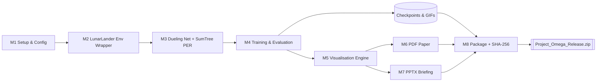

# 🏗 Architecture — Project Omega

> Part of [omega](https://github.com/shiroonigami23-ui/omega). Back to the [README](../README.md).

## 1. System Overview

Omega is organised as a sequence of self-contained Python modules that share state through a global config object and
a Google-Drive-backed output directory. Modules 1–4 produce learning artefacts (checkpoints, metrics, GIFs); Modules 5–7
turn those artefacts into human-readable outputs; Module 8 orchestrates the full run and packages everything.

## 2. Components

| Component | Location | Responsibility |
|---|---|---|
| **Setup & config** | `delivery_full/source_code/project_omega_m1_m2.py` | Dataclass config, logging, seeding, Drive mounting |
| **Env wrapper** | `delivery_full/source_code/project_omega_m1_m2.py` | LunarLander-v2 wrapper, reward shaping, running-mean normalisation |
| **Networks & replay** | `delivery_full/source_code/project_omega_m3.py` | Standard and dueling Q-networks, SumTree PER buffer |
| **Trainer** | `delivery_full/source_code/project_omega_m4.py` | ε-greedy training loop, Double-DQN targets, checkpoints, evaluation, GIFs |
| **Plots** | `delivery_full/source_code/project_omega_m5.py` | All performance / distribution / ablation figures |
| **Paper** | `delivery_full/source_code/project_omega_m6.py` | PDF research-paper compiler |
| **Slides** | `delivery_full/source_code/project_omega_m7.py` | PPTX executive briefing compiler |
| **Orchestrator** | `delivery_full/source_code/project_omega_m8.py` | Runs every variant, zips outputs, writes SHA-256 manifest |

## 3. Data / Control Flow

1. Module 8 iterates over the four variants (dueling ∈ {F,T} × PER ∈ {F,T}).
2. For each variant the trainer interacts with the wrapped environment, storing transitions in uniform or prioritised replay.
3. Every N episodes a checkpoint and metrics row are written; the best agent is rendered to GIF.
4. After all variants finish, Module 5 renders every figure from the metrics CSVs.
5. Modules 6 and 7 embed the figures and tables into the PDF paper and the PPTX deck.
6. Module 8 zips models, plots, reports, videos and logs and writes a hash manifest.

## 4. Key Design Decisions

| Decision | Rationale |
|---|---|
| Modules executed with exec() in one session | Matches the Colab workflow — each module can be re-run independently after a disconnect |
| SumTree for PER | O(log n) sampling and priority updates for large buffers |
| Google Drive checkpointing | Colab sessions are pre-emptible; overnight runs must survive restarts |
| Reports generated from CSV | Single source of truth — figures, paper and slides never drift from the data |

## 5. Known Limitations

- Single seed per variant — results have high variance
- 400-episode budget is too short for a stable LunarLander solve
- Module chaining via exec() is not import-friendly

---
*Last updated: 2026-11-14*
